# MidProject-Jarkom_K7_085_100_116

# Soal 1 - Topologi

Pada implementasi jaringan Smart City Kota Surabaya, kelompok menggunakan skema **Classless Inter-Domain Routing (CIDR)** sebagai metode pengalamatan jaringan.

CIDR dipilih karena memungkinkan penggunaan prefix yang berbeda sesuai kebutuhan jumlah host pada setiap subnet. Dengan demikian, alokasi alamat IP dapat disesuaikan dengan skala masing-masing jaringan, mulai dari jaringan WiFi publik dengan kebutuhan host yang besar hingga jaringan server dan koneksi antar-router dengan kebutuhan host yang lebih kecil.

Jaringan menggunakan blok alamat `10.56.0.0/15` yang dibagi menjadi beberapa subnet untuk masing-masing lokasi. Setiap LAN menggunakan alamat host pertama sebagai default gateway sesuai ketentuan tugas.

### Desain Topologi Jaringan


Topologi jaringan dirancang menggunakan pendekatan hierarkis dengan R-PUSAT sebagai router utama yang menghubungkan beberapa wilayah, yaitu DC, Utara, Barat, Timur, Selatan, dan Pelabuhan.

Secara keseluruhan, perangkat jaringan terdiri atas delapan router, switch, perangkat pengguna, access point, dan server. Setiap lokasi memiliki router yang berfungsi sebagai penghubung antara jaringan lokal dengan jaringan backbone.

R-PUSAT berfungsi sebagai pusat konektivitas yang menghubungkan router-router wilayah lainnya serta R-ISP untuk akses menuju jaringan internet. Sementara itu, R-UTARA berfungsi sebagai penghubung tambahan menuju R-PELABUHAN melalui link L6.

### Pertimbangan Pemilihan Perangkat

| Perangkat | Pertimbangan Pemilihan |
|---|---|
| Cisco 2911 Router | Digunakan sebagai perangkat routing untuk menghubungkan beberapa subnet dan jaringan antarwilayah. |
| Cisco 2960 Switch | Digunakan untuk menghubungkan beberapa perangkat dalam satu LAN melalui koneksi kabel. |
| PC-PT | Digunakan sebagai perangkat perwakilan untuk jaringan pengguna atau perangkat monitoring pada setiap LAN. |
| Server-PT | Digunakan untuk menyediakan layanan jaringan seperti DNS, web, FTP, email, DHCP, dan server internet sesuai pembagian layanan. |
| Access Point-PT | Digunakan untuk menyediakan konektivitas wireless pada jaringan WiFi publik. |
| Laptop-PT | Digunakan sebagai perangkat perwakilan pengguna yang mengakses jaringan melalui koneksi wireless. |

### Pertimbangan Media Koneksi

Media koneksi dipilih berdasarkan kebutuhan komunikasi antarperangkat dan karakteristik masing-masing jaringan.

**a. Koneksi Backbone Antar-Router**

Backbone L1–L6 menggunakan kabel serial dengan modul HWIC-2T pada router Cisco 2911. Media ini dipilih sebagai desain koneksi point-to-point antar-router untuk menghubungkan jaringan di berbagai wilayah.

Penambahan modul HWIC-2T dilakukan karena router Cisco 2911 yang digunakan memerlukan antarmuka serial tambahan untuk mendukung koneksi backbone. R-PUSAT menggunakan tiga modul HWIC-2T untuk memenuhi kebutuhan enam port serial, sedangkan router lainnya menggunakan satu modul sesuai kebutuhan koneksinya.

**b. Koneksi Router ke Switch**

Koneksi antara router dan switch menggunakan kabel Copper Straight-Through. Media ini digunakan untuk menghubungkan interface GigabitEthernet pada router dengan interface FastEthernet pada switch sehingga masing-masing LAN dapat terhubung ke gateway-nya.

**c. Koneksi Switch ke Perangkat LAN**

Koneksi antara switch dengan PC, server, dan access point menggunakan kabel Copper Straight-Through. Penggunaan koneksi kabel dipilih untuk menyediakan jalur komunikasi langsung bagi perangkat dalam jaringan lokal.

**d. Koneksi Wireless**

Jaringan WiFi publik di wilayah Utara, Barat, Timur, dan Selatan menggunakan Access Point sebagai penyedia akses wireless. Laptop digunakan sebagai perangkat perwakilan pengguna yang terhubung ke Access Point tanpa memerlukan kabel fisik.

Pemilihan wireless bertujuan memberikan fleksibilitas konektivitas bagi pengguna yang mengakses jaringan publik.

### Pertimbangan Pembagian Switch dan LAN

Setiap wilayah memiliki switch yang dipisahkan berdasarkan subnet atau fungsi jaringan. Pemisahan ini dilakukan agar perangkat dalam satu kelompok jaringan terhubung melalui switch masing-masing.

Sebagai contoh, wilayah DC memiliki SW-CCTV dan SW-SERVER-DC. Keduanya digunakan untuk menghubungkan perangkat pada subnet CCTV Kota serta Server dan Storage DC.

Pembagian serupa diterapkan pada wilayah lainnya, seperti WiFi publik, jaringan sensor, jaringan perkantoran, dan jaringan server.

Pemisahan switch tersebut membantu pengelolaan perangkat berdasarkan fungsi dan subnet masing-masing serta memudahkan proses konfigurasi dan pengujian jaringan.

### Pertimbangan Jumlah Perangkat Perwakilan

Dalam implementasi menggunakan Cisco Packet Tracer, kelompok hanya memasang satu perangkat perwakilan untuk setiap LAN sesuai ketentuan tugas.

Meskipun demikian, perhitungan subnet tetap menggunakan seluruh kebutuhan host yang telah ditentukan pada UTS. Oleh karena itu, jumlah perangkat yang ditampilkan dalam simulasi tidak merepresentasikan keseluruhan kapasitas atau kebutuhan host pada jaringan sebenarnya.

Pendekatan ini digunakan untuk menyederhanakan simulasi tanpa mengubah perencanaan pengalamatan jaringan.

### Kesimpulan Desain

Desain topologi ini dibuat untuk merepresentasikan jaringan Smart City Kota Surabaya yang menghubungkan berbagai wilayah melalui jaringan backbone dengan R-PUSAT sebagai pusat konektivitas.

Penggunaan router, switch, server, access point, serta kombinasi media kabel dan wireless disesuaikan dengan kebutuhan masing-masing jaringan. Dengan desain tersebut, jaringan diharapkan dapat mendukung komunikasi antarwilayah, akses pengguna, serta penyediaan layanan jaringan sesuai ketentuan Mid-Project Komunikasi Data dan Jaringan Komputer.
  
# Soal 3 - Static Routing

Konfigurasi static routing dilakukan agar seluruh jaringan LAN pada topologi Smart City Surabaya dapat saling berkomunikasi melalui router yang terhubung. Setiap router diberikan rute menuju jaringan yang tidak terhubung secara langsung menggunakan static route.

Sesuai ketentuan soal, R-PUSAT dan R-UTARA harus memiliki static route menuju seluruh jaringan LAN yang berada di bawah router cabangnya. Selain itu, setiap router cabang menggunakan default route untuk meneruskan paket menuju jaringan di luar jaringan lokalnya.

### Konfigurasi Interface Router

Sebelum melakukan konfigurasi routing, setiap interface router diberikan alamat IP statis sesuai tabel subnetting CIDR yang telah dibuat pada Soal 2.

Interface LAN berfungsi sebagai gateway bagi perangkat pengguna, sedangkan interface serial digunakan untuk menghubungkan router-router pada backbone jaringan.

Seluruh interface yang digunakan telah dikonfigurasi dan menunjukkan status `up/up` berdasarkan pemeriksaan menggunakan perintah:

```cisco
show ip interface brief
```

### Konfigurasi Static Route pada R-PUSAT

R-PUSAT berfungsi sebagai router pusat yang menghubungkan jaringan Balai Kota dengan router-router cabang lainnya. Oleh karena itu, R-PUSAT dikonfigurasi dengan static route menuju seluruh LAN yang berada di bawah R-DC, R-UTARA, R-BARAT, R-TIMUR, R-SELATAN, dan R-PELABUHAN.

Berikut daftar static route pada R-PUSAT:

| Jaringan Tujuan | Next Hop | Keterangan |
|---|---|---|
| 10.56.128.0/19 | 10.56.161.2 | LAN CCTV Kota |
| 10.56.160.0/24 | 10.56.161.2 | LAN Server dan Storage DC |
| 10.56.0.0/18 | 10.56.66.2 | LAN WiFi Publik Utara |
| 10.56.64.0/23 | 10.56.66.2 | LAN Sensor Lalu Lintas Utara |
| 10.56.192.0/19 | 10.56.225.2 | LAN WiFi Publik Barat |
| 10.56.224.0/24 | 10.56.225.2 | LAN Puskesmas dan Sekolah Barat |
| 10.57.0.0/19 | 10.57.36.2 | LAN WiFi Publik Timur |
| 10.57.32.0/22 | 10.57.36.2 | LAN Sensor Banjir Timur |
| 10.57.64.0/19 | 10.57.96.130 | LAN WiFi Publik Selatan |
| 10.57.96.0/25 | 10.57.96.130 | LAN PJU Pintar Selatan |
| 10.57.128.0/19 | 10.56.66.2 | LAN Sensor dan SCADA Pelabuhan |
| 10.57.160.0/25 | 10.56.66.2 | LAN Kantor Pelabuhan |
| 10.57.160.128/30 | 10.56.66.2 | Link L6 menuju R-PELABUHAN |

Selain static route menuju jaringan cabang, R-PUSAT juga dikonfigurasi dengan default route menuju R-ISP menggunakan perintah:

```cisco
ip route 0.0.0.0 0.0.0.0 203.0.113.30
```

Default route tersebut digunakan untuk meneruskan paket menuju jaringan di luar jaringan internal Smart City melalui R-ISP.  

  

R-PUSAT memiliki static route menuju seluruh LAN cabang dan default route menuju R-ISP.

### Konfigurasi Static Route pada R-UTARA

R-UTARA memiliki dua jaringan LAN lokal, yaitu WiFi Publik Utara dan Sensor Lalu Lintas Utara. R-UTARA juga terhubung ke R-PELABUHAN melalui link L6.

Sesuai ketentuan soal, R-UTARA dikonfigurasi dengan static route menuju seluruh LAN milik R-PELABUHAN.

Konfigurasi static route:

```cisco
ip route 10.57.128.0 255.255.224.0 10.57.160.130
ip route 10.57.160.0 255.255.255.128 10.57.160.130
```

Default route pada R-UTARA diarahkan menuju R-PUSAT:

```cisco
ip route 0.0.0.0 0.0.0.0 10.56.66.1
```

Dengan demikian, R-UTARA dapat meneruskan paket menuju jaringan Pelabuhan melalui L6 dan meneruskan paket menuju jaringan lainnya melalui R-PUSAT.

  
  
R-UTARA memiliki static route menuju LAN Sensor dan SCADA Pelabuhan serta LAN Kantor Pelabuhan.  

### Konfigurasi Default Route pada Router Cabang

Router cabang lainnya dikonfigurasi menggunakan default route menuju router yang menjadi jalur keluar atau upstream masing-masing.

| Router | Default Route / Next Hop | Tujuan |
|---|---|---|
| R-DC | 10.56.161.1 | Menuju R-PUSAT melalui L1 |
| R-BARAT | 10.56.225.1 | Menuju R-PUSAT melalui L5 |
| R-TIMUR | 10.57.36.1 | Menuju R-PUSAT melalui L4 |
| R-SELATAN | 10.57.96.129 | Menuju R-PUSAT melalui L3 |
| R-PELABUHAN | 10.57.160.129 | Menuju R-UTARA melalui L6 |

Contoh konfigurasi default route pada R-PELABUHAN:

```cisco
ip route 0.0.0.0 0.0.0.0 10.57.160.129
```

Konfigurasi tersebut memungkinkan router cabang meneruskan paket menuju jaringan yang tidak tercantum sebagai jaringan lokal maupun static route khusus melalui router upstream.

  
  
Router cabang memiliki default route menuju router upstream masing-masing.  
Jaringan yang terhubung langsung ditampilkan sebagai connected route, sedangkan jaringan yang dikonfigurasi secara manual ditampilkan sebagai static route.  

### Pengujian Konektivitas

Pengujian dilakukan menggunakan perintah `ping` untuk memastikan bahwa perangkat dan router dapat menjangkau jaringan tujuan.

Beberapa hasil pengujian yang berhasil:

| Sumber Pengujian | Tujuan | Hasil |
|---|---|---|
| PC-PEGAWAI | Gateway CCTV Kota (10.56.128.1) | Berhasil |
| PC-CCTV-KOTA | PC-PEGAWAI (10.57.192.2) | Berhasil |
| PC-PEGAWAI | Gateway WiFi Publik Utara (10.56.0.1) | Berhasil |
| PC-PEGAWAI | Gateway WiFi Publik Barat (10.56.192.1) | Berhasil |
| PC-PEGAWAI | Gateway WiFi Publik Timur (10.57.0.1) | Berhasil |
| PC-PEGAWAI | Gateway WiFi Publik Selatan (10.57.64.1) | Berhasil |
| PC-PEGAWAI | Gateway Puskesmas dan Sekolah Barat (10.56.224.1) | Berhasil |
| PC-PEGAWAI | Gateway Sensor Banjir Timur (10.57.32.1) | Berhasil |
| PC-PEGAWAI | Gateway Sensor Lalu Lintas Utara (10.56.64.1) | Berhasil |
| PC-PEGAWAI | Gateway PJU Pintar Selatan (10.57.96.1) | Berhasil |
| PC-PEGAWAI | Gateway Sensor dan SCADA Pelabuhan (10.57.128.1) | Berhasil |
| PC-PEGAWAI | Gateway Kantor Pelabuhan (10.57.160.1) | Berhasil |
| PC-PEGAWAI | Gateway Server dan Storage DC (10.56.160.1) | Berhasil |
| PC-PEGAWAI | Gateway Server Balai Kota (10.57.200.1) | Berhasil |  

  
  

Pengujian tambahan dilakukan dari R-UTARA menuju gateway LAN Pelabuhan:

- `ping 10.57.128.1` — berhasil.
- `ping 10.57.160.1` — berhasil.
  
  

Pengujian dari R-PELABUHAN menuju gateway LAN Pegawai Balai Kota juga berhasil setelah penambahan static route untuk jaringan link L6 pada R-PUSAT.  
  

Hasil pengujian tersebut menunjukkan bahwa routing antarjaringan telah berjalan sesuai jalur yang dikonfigurasi.  

# Soal 4 - Konfigurasi DHCP (Dynamic Host Configuration Protocol)

Konfigurasi DHCP dilakukan untuk memberikan alamat IP secara otomatis kepada perangkat pengguna pada jaringan Smart City Surabaya. Setiap perangkat pengguna memperoleh konfigurasi jaringan berupa IP Address, Subnet Mask, Default Gateway, dan DNS Server tanpa perlu melakukan pengaturan secara manual.

Sesuai ketentuan soal, seluruh interface router dan server menggunakan alamat IP statis. Khusus subnet CCTV Kota, alokasi alamat IP dilakukan oleh DHCP Server yang berada di LAN Server dan Storage DC, bukan oleh router.

Implementasi DHCP dilakukan menggunakan dua metode, yaitu DHCP Server pada SERVER-DC untuk subnet CCTV Kota dan DHCP pool pada masing-masing router untuk LAN pengguna lainnya.

### Konfigurasi IP Statis Server

Sebelum mengaktifkan layanan DHCP, kedua server dikonfigurasi menggunakan alamat IP statis.

| Perangkat | IP Address | Subnet Mask | Default Gateway | DNS Server |
|---|---|---|---|---|
| SERVER-DC | 10.56.160.2 | 255.255.255.0 | 10.56.160.1 | 10.56.160.2 |
| SERVER-BALAI | 10.57.200.2 | 255.255.255.224 | 10.57.200.1 | 10.56.160.2 |

### DHCP Server untuk CCTV Kota

DHCP Server dikonfigurasi pada SERVER-DC yang terhubung ke LAN Server dan Storage DC. Pada menu **Services → DHCP**, layanan DHCP diaktifkan dan dibuat pool dengan nama `CCTV_POOL`.

Konfigurasi pool CCTV Kota:

| Parameter | Nilai |
|---|---|
| Pool Name | CCTV_POOL |
| Default Gateway | 10.56.128.1 |
| DNS Server | 10.56.160.2 |
| Start IP Address | 10.56.128.10 |
| Subnet Mask | 255.255.224.0 |
| Maximum Users | 6000 |
| DHCP Service | On |

Agar permintaan DHCP dari subnet CCTV Kota dapat diteruskan menuju SERVER-DC yang berada di subnet berbeda, dilakukan konfigurasi DHCP Relay pada interface G0/0 milik R-DC menggunakan perintah:

```cisco
interface gigabitEthernet 0/0
ip helper-address 10.56.160.2
```

Dengan konfigurasi tersebut, permintaan DHCP dari perangkat CCTV diteruskan oleh R-DC ke SERVER-DC. Dengan demikian, alamat IP CCTV Kota diperoleh dari DHCP Server, bukan dari router.

### DHCP pada Router untuk LAN Pengguna Lainnya

Untuk LAN pengguna selain CCTV Kota, DHCP dikonfigurasi secara lokal pada router yang menjadi gateway masing-masing subnet.

Sebelum membuat DHCP pool, alamat IP 10.1 sampai 10.9 pada setiap subnet dikecualikan dari pembagian DHCP. Hal ini bertujuan untuk menghindari konflik dengan alamat gateway dan alamat yang disediakan untuk kebutuhan statis.

Konfigurasi DHCP menggunakan tiga parameter utama:
- `network` untuk menentukan network ID dan subnet mask.
- `default-router` untuk memberikan alamat gateway kepada perangkat pengguna.
- `dns-server` untuk memberikan alamat DNS Server, yaitu 10.56.160.2.

Berikut daftar DHCP pool yang dikonfigurasi:

| Router | Nama DHCP Pool | Network ID / Prefix | Gateway | Awal IP DHCP |
|---|---|---|---|---|
| R-PUSAT | PEGAWAI_BALAI | 10.57.192.0/21 | 10.57.192.1 | 10.57.192.10 |
| R-UTARA | WIFI_UTARA | 10.56.0.0/18 | 10.56.0.1 | 10.56.0.10 |
| R-UTARA | SENSOR_LALIN_UTARA | 10.56.64.0/23 | 10.56.64.1 | 10.56.64.10 |
| R-BARAT | WIFI_BARAT | 10.56.192.0/19 | 10.56.192.1 | 10.56.192.10 |
| R-BARAT | PUSKESMAS_SEKOLAH | 10.56.224.0/24 | 10.56.224.1 | 10.56.224.10 |
| R-TIMUR | WIFI_TIMUR | 10.57.0.0/19 | 10.57.0.1 | 10.57.0.10 |
| R-TIMUR | SENSOR_BANJIR_TIMUR | 10.57.32.0/22 | 10.57.32.1 | 10.57.32.10 |
| R-SELATAN | WIFI_SELATAN | 10.57.64.0/19 | 10.57.64.1 | 10.57.64.10 |
| R-SELATAN | PJU_SELATAN | 10.57.96.0/25 | 10.57.96.1 | 10.57.96.10 |
| R-PELABUHAN | SENSOR_SCADA_PELABUHAN | 10.57.128.0/19 | 10.57.128.1 | 10.57.128.10 |
| R-PELABUHAN | KANTOR_PELABUHAN | 10.57.160.0/25 | 10.57.160.1 | 10.57.160.10 |

DNS Server pada seluruh DHCP pool diarahkan ke alamat 10.56.160.2, yaitu SERVER-DC. Alamat tersebut dipersiapkan untuk layanan DNS pada Soal 8.

### Pengujian DHCP

Pengujian dilakukan dengan mengubah konfigurasi IPv4 pada setiap perangkat pengguna menjadi DHCP melalui menu **Desktop → IP Configuration**. Hasil pengujian menunjukkan bahwa seluruh perangkat perwakilan memperoleh alamat IP secara otomatis beserta subnet mask, default gateway, dan DNS Server yang sesuai dengan subnet masing-masing.

### Hasil Pengujian Perangkat Pengguna

| No. | Perangkat | IPv4 Address yang Diperoleh | Gateway | Hasil |
|---|---|---|---|---|
| 1 | PC-PEGAWAI | 10.57.192.10 | 10.57.192.1 | Berhasil |
| 2 | LAPTOP-WIFI-UTARA | 10.56.0.10 | 10.56.0.1 | Berhasil |
| 3 | PC-SENSOR-LALIN | 10.56.64.10 | 10.56.64.1 | Berhasil |
| 4 | LAPTOP-WIFI-BARAT | 10.56.192.10 | 10.56.192.1 | Berhasil |
| 5 | PC-PUSKESMAS | 10.56.224.10 | 10.56.224.1 | Berhasil |
| 6 | LAPTOP-WIFI-TIMUR | 10.57.0.10 | 10.57.0.1 | Berhasil |
| 7 | PC-SENSOR-BANJIR | 10.57.32.10 | 10.57.32.1 | Berhasil |
| 8 | LAPTOP-WIFI-SELATAN | 10.57.64.10 | 10.57.64.1 | Berhasil |
| 9 | PC-PJU | 10.57.96.10 | 10.57.96.1 | Berhasil |
| 10 | PC-SCADA | 10.57.128.10 | 10.57.128.1 | Berhasil |
| 11 | PC-KANTOR-PELABUHAN | 10.57.160.10 | 10.57.160.1 | Berhasil |
| 12 | PC-CCTV-KOTA | 10.56.128.10 | 10.56.128.1 | Berhasil |

Beberapa contoh hasil pengujian:  
  
  
  
  
  

Seluruh perangkat memperoleh DNS Server 10.56.160.2. Pada setiap perangkat, proses pengujian menampilkan pesan **DHCP request successful**.

### Verifikasi DHCP Binding

Selain melalui IP Configuration pada perangkat pengguna, pemberian alamat IP juga diverifikasi melalui perintah `show ip dhcp binding` pada router.

Contoh hasil verifikasi pada R-PUSAT:


Hasil tersebut menunjukkan bahwa alamat 10.57.192.10 telah tercatat sebagai alamat yang diberikan secara otomatis kepada PC-PEGAWAI.

Verifikasi pada R-PELABUHAN:


Hasil tersebut membuktikan bahwa PC-SCADA dan PC-KANTOR-PELABUHAN telah memperoleh alamat IP melalui DHCP pada R-PELABUHAN.

# Soal 5 - Konfigurasi NAT Overload (PAT)

Konfigurasi **Network Address Translation (NAT) Overload** atau **Port Address Translation (PAT)** dilakukan pada **R-PUSAT** agar seluruh perangkat pengguna di jaringan internal Smart City Kota Surabaya dapat mengakses jaringan internet (`8.8.8.8`) menggunakan satu alamat IP publik milik R-PUSAT.

Sesuai ketentuan tugas untuk **Kelompok 7 ($K = 7$)**, koneksi antara R-PUSAT dan R-ISP menggunakan blok alamat publik `203.0.113.28/30`, sedangkan jaringan internet direpresentasikan oleh `SERVER-INTERNET` pada subnet `8.8.8.0/24`. Pada sisi R-ISP tidak dikonfigurasikan rute menuju jaringan privat internal (`10.56.0.0/15`), sehingga komunikasi menuju internet sepenuhnya bergantung pada proses translasi alamat di R-PUSAT.

### Alokasi Pengalamatan IP Publik dan Internet

Sebelum mengaktifkan NAT Overload, dilakukan konfigurasi pengalamatan IP pada jalur penghubung antara R-PUSAT, R-ISP, dan SERVER-INTERNET sesuai perhitungan $K = 7$:

| Perangkat | Interface | IP Address | Subnet Mask | Keterangan |
|---|---|---|---|---|
| R-PUSAT | Serial0/2/1 | 203.0.113.29 | 255.255.255.252 | Interface publik (`ip nat outside`) menuju R-ISP |
| R-ISP | Serial0/0/0 | 203.0.113.30 | 255.255.255.252 | Interface serial menuju R-PUSAT |
| R-ISP | GigabitEthernet0/0 | 8.8.8.1 | 255.255.255.0 | Gateway jaringan internet |
| SERVER-INTERNET | FastEthernet0 | 8.8.8.8 | 255.255.255.0 | Server tujuan pengujian akses internet |

### Konfigurasi pada R-ISP

R-ISP dikonfigurasikan dengan alamat IP pada interface yang mengarah ke R-PUSAT dan SERVER-INTERNET tanpa menambahkan static route maupun default route menuju blok alamat privat `10.0.0.0/8`:

```cisco
interface GigabitEthernet0/0
 ip address 8.8.8.1 255.255.255.0
 no shutdown
!
interface Serial0/0/0
 ip address 203.0.113.30 255.255.255.252
 no shutdown
```

### Konfigurasi Interface Inside dan Outside pada R-PUSAT

Agar host dari seluruh wilayah (Balai Kota, DC, Utara, Barat, Timur, Selatan, dan Pelabuhan) dapat ditranslasikan saat mengakses internet, seluruh interface internal R-PUSAT ditetapkan sebagai `ip nat inside`, sedangkan interface yang terhubung ke R-ISP ditetapkan sebagai `ip nat outside`.

| Interface R-PUSAT | Alamat IP | Peran NAT | Koneksi Jaringan |
|---|---|---|---|
| Serial0/2/1 | 203.0.113.29/30 | `ip nat outside` | Link menuju R-ISP |
| GigabitEthernet0/0 | 10.57.192.1/21 | `ip nat inside` | LAN Pegawai Balai Kota |
| GigabitEthernet0/1 | 10.57.200.1/27 | `ip nat inside` | LAN Server Balai Kota |
| Serial0/0/0 | 10.56.161.1/30 | `ip nat inside` | Link L1 menuju R-DC |
| Serial0/0/1 | 10.56.66.1/30 | `ip nat inside` | Link L2 menuju R-UTARA & R-PELABUHAN |
| Serial0/1/0 | 10.57.96.129/30 | `ip nat inside` | Link L3 menuju R-SELATAN |
| Serial0/1/1 | 10.57.36.1/30 | `ip nat inside` | Link L4 menuju R-TIMUR |
| Serial0/2/0 | 10.56.225.1/30 | `ip nat inside` | Link L5 menuju R-BARAT |

### Konfigurasi Access-List dan PAT pada R-PUSAT

Selanjutnya dibuat Standard Access-List (`access-list 10`) untuk mengizinkan seluruh lalu lintas dari jaringan internal `10.0.0.0/8` dan menghubungkannya dengan interface keluar `Serial0/2/1` menggunakan opsi `overload`:

```cisco
interface Serial0/2/1
 ip nat outside
!
interface GigabitEthernet0/0
 ip nat inside
interface GigabitEthernet0/1
 ip nat inside
interface Serial0/0/0
 ip nat inside
interface Serial0/0/1
 ip nat inside
interface Serial0/1/0
 ip nat inside
interface Serial0/1/1
 ip nat inside
interface Serial0/2/0
 ip nat inside
!
ip route 0.0.0.0 0.0.0.0 203.0.113.30
!
access-list 10 permit 10.0.0.0 0.255.255.255
ip nat inside source list 10 interface Serial0/2/1 overload
```

Dengan opsi `overload`, R-PUSAT menerjemahkan banyak alamat IP privat internal menjadi satu alamat IP publik (`203.0.113.29`) secara bersamaan dengan membedakan nomor port pada setiap sesi komunikasi.

### Pengujian dan Verifikasi NAT Overload

Pengujian dilakukan melalui tiga tahap verifikasi untuk memastikan seluruh ketentuan Soal 5 terpenuhi:

**1. Pengujian Konektivitas Internet (`ping 8.8.8.8`)**

Pengujian dilakukan dari perangkat pengguna pada beberapa wilayah menuju alamat `8.8.8.8` (`SERVER-INTERNET`):

| Sumber Pengujian | IPv4 Perangkat | Tujuan | Hasil |
|---|---|---|---|
| PC-PEGAWAI | 10.57.192.10 | 8.8.8.8 | Berhasil (0% loss) |
| PC-KANTOR-PELABUHAN | 10.57.160.10 | 8.8.8.8 | Berhasil (0% loss) |

**2. Verifikasi Tabel Translasi NAT pada R-PUSAT**

Pemeriksaan tabel translasi dilakukan pada R-PUSAT menggunakan perintah:

```cisco
show ip nat translations
```


Hasil verifikasi menunjukkan bahwa alamat IP privat dari berbagai subnet (`10.57.160.10` dan `10.57.192.10`) tercatat pada kolom **Inside local** dan diterjemahkan menjadi satu IP publik `203.0.113.29` pada kolom **Inside global** dengan pembeda nomor port (`203.0.113.29:1`–`4` dan `203.0.113.29:59`–`62`).

**3. Verifikasi Tabel Routing pada R-ISP**

Pemeriksaan tabel routing dilakukan pada R-ISP menggunakan perintah:

```cisco
show ip route
```


Hasil pemeriksaan membuktikan bahwa R-ISP hanya memiliki entri rute terhubung langsung (`C` dan `L`) untuk jaringan `8.8.8.0/24` dan `203.0.113.28/30`, serta tidak memiliki rute menuju jaringan privat `10.0.0.0/8`. Hal ini membuktikan bahwa akses internet dari jaringan internal berjalan melalui mekanisme NAT Overload pada R-PUSAT.

# Soal 6 - Konfigurasi Tunnel GRE

Konfigurasi **Generic Routing Encapsulation (GRE) Tunnel** dilakukan untuk membentuk jalur komunikasi virtual *point-to-point* secara langsung antara **R-PUSAT** dan **R-PELABUHAN** melalui jaringan backbone yang melewati R-UTARA.

Dengan adanya tunnel ini, pertukaran data antara jaringan Balai Kota (`Pegawai Balai Kota` dan `Server Balai Kota`) dengan jaringan Pelabuhan (`Sensor dan SCADA Pelabuhan` dan `Kantor Pelabuhan`) diteruskan melalui terowongan logis tanpa perlu melalui proses routing hop-demi-hop pada router perantara (R-UTARA).

### Alokasi Pengalamatan Tunnel GRE

Sesuai ketentuan tugas untuk **Kelompok 7 ($K = 7$)**, interface virtual `Tunnel0` menggunakan blok alamat `192.168.7.0/30` dengan titik akhir (*tunnel endpoint*) mengacu pada interface fisik serial masing-masing router yang terhubung ke jaringan backbone:

| Perangkat | Interface Tunnel | IP Tunnel | Subnet Mask | Tunnel Source | Tunnel Destination |
|---|---|---|---|---|---|
| R-PUSAT | Tunnel0 | 192.168.7.1 | 255.255.255.252 | Serial0/0/1 (10.56.66.1) | 10.57.160.130 (Serial0/0/0 R-PELABUHAN) |
| R-PELABUHAN | Tunnel0 | 192.168.7.2 | 255.255.255.252 | Serial0/0/0 (10.57.160.130) | 10.56.66.1 (Serial0/0/1 R-PUSAT) |

### Konfigurasi Tunnel GRE dan Routing pada R-PUSAT

Pada **R-PUSAT**, static route lama menuju subnet Pelabuhan yang sebelumnya melewati R-UTARA (`10.56.66.2`) dihapus terlebih dahulu agar tidak terjadi *load-balancing* jalur. Selanjutnya dibuat interface `Tunnel0` dan ditambahkan static route baru yang mengarahkan lalu lintas menuju subnet Pelabuhan ke alamat tunnel `192.168.7.2`:

```cisco
no ip route 10.57.128.0 255.255.224.0 10.56.66.2
no ip route 10.57.160.0 255.255.255.128 10.56.66.2
!
interface Tunnel0
 ip address 192.168.7.1 255.255.255.252
 tunnel source Serial0/0/1
 tunnel destination 10.57.160.130
 tunnel mode gre ip
 no shutdown
!
ip route 10.57.128.0 255.255.224.0 192.168.7.2
ip route 10.57.160.0 255.255.255.128 192.168.7.2
```

### Konfigurasi Tunnel GRE dan Routing pada R-PELABUHAN

Pada **R-PELABUHAN**, dibuat interface `Tunnel0` yang mengarah ke interface fisik R-PUSAT (`10.56.66.1`), kemudian ditambahkan static route spesifik menuju subnet Pegawai Balai Kota dan Server Balai Kota melalui alamat tunnel `192.168.7.1`. Sementara itu, default route menuju R-UTARA (`10.57.160.129`) tetap dipertahankan untuk lalu lintas umum dan akses internet:

```cisco
interface Tunnel0
 ip address 192.168.7.2 255.255.255.252
 tunnel source Serial0/0/0
 tunnel destination 10.56.66.1
 tunnel mode gre ip
 no shutdown
!
ip route 10.57.192.0 255.255.248.0 192.168.7.1
ip route 10.57.200.0 255.255.255.224 192.168.7.1
```

### Pengujian dan Verifikasi Tunnel GRE

**1. Verifikasi Status Interface Tunnel0**

Pemeriksaan status interface dilakukan pada R-PUSAT dan R-PELABUHAN menggunakan perintah:

```cisco
show ip interface brief
```


Hasil verifikasi menunjukkan bahwa interface `Tunnel0` pada R-PUSAT (`192.168.7.1`) maupun R-PELABUHAN (`192.168.7.2`) berada dalam kondisi `up/up`, menandakan terowongan virtual telah terbentuk dan siap meneruskan paket.

**2. Pelacakan Jalur Paket (`tracert`) Antar-LAN**

Pengujian jalur dilakukan dari **PC-PEGAWAI** (`10.57.192.10`) menuju **PC-KANTOR-PELABUHAN** (`10.57.160.10`) menggunakan perintah `tracert`:

```cmd
tracert 10.57.160.10
```


Hasil `tracert` menunjukkan paket melewati rute berikut:
1. **Hop 1 (`10.57.192.1`)**: Default gateway pada R-PUSAT.
2. **Hop 2 (`192.168.7.2`)**: Ujung interface `Tunnel0` milik R-PELABUHAN.
3. **Hop 3 (`10.57.160.10`)**: Perangkat tujuan PC-KANTOR-PELABUHAN.

Terlihat bahwa lalu lintas dari Balai Kota ke Pelabuhan hanya membutuhkan 3 hop dan langsung diteruskan melalui `192.168.7.2` tanpa melewati hop router perantara R-UTARA.

### Analisis Konsep Tunnel GRE

**1. Mengapa Router Memilih Jalur Tunnel Dibandingkan Jalur Lain ke Pelabuhan?**

Router menentukan jalur penerusan paket berdasarkan prinsip **Longest Prefix Match**, yaitu memprioritaskan entri rute di tabel routing yang memiliki *subnet mask* (panjang prefix) paling spesifik:
- Pada **R-PELABUHAN**, lalu lintas umum diteruskan menggunakan default route `0.0.0.0/0` menuju R-UTARA. Ketika ditambahkan static route spesifik menuju subnet Pegawai Balai Kota (`10.57.192.0/21`) dan Server Balai Kota (`10.57.200.0/27`) dengan *next-hop* `192.168.7.1`, prefix `/21` dan `/27` jauh lebih spesifik dibandingkan `/0`, sehingga router otomatis memilih jalur tunnel.
- Pada **R-PUSAT**, rute menuju subnet Pelabuhan (`10.57.128.0/19` dan `10.57.160.0/25`) diarahkan secara spesifik ke *next-hop* `192.168.7.2` menggantikan rute fisik lama via R-UTARA. Secara logis, R-PUSAT melihat R-PELABUHAN terhubung langsung dalam satu subnet point-to-point `192.168.7.0/30`.

**2. Mengapa GRE Saja Tidak Mengenkripsi Data?**

Protokol **GRE (Generic Routing Encapsulation)** dirancang semata-mata untuk fungsi **enkapsulasi**, yaitu membungkus paket IP asli ke dalam *header* GRE dan *header* IP luar baru agar paket dapat melintasi jaringan perantara seolah-olah melalui koneksi *point-to-point* langsung.

GRE tidak memiliki mekanisme kriptografi—baik algoritma enkripsi untuk menjaga kerahasiaan data (*confidentiality*), *hashing* untuk menjamin keutuhan data (*integrity*), maupun autentikasi pengirim (*authentication*). Akibatnya, seluruh muatan (*payload*) paket yang melewati tunnel GRE tetap dikirim dalam bentuk *plaintext* dan masih dapat dibaca apabila lalu lintas disadap (*packet sniffing*) di jalur backbone. Untuk mengamankan isi paket di dalam terowongan GRE, diperlukan protokol keamanan tambahan seperti **IPsec** (*GRE over IPsec*).

# Soal 8 - Layanan Aplikasi Smart City

Konfigurasi layanan aplikasi dilakukan agar jaringan Smart City Kota Surabaya menyediakan layanan DNS, web, FTP, dan email yang dapat diakses dari seluruh wilayah. Sesuai ketentuan tugas untuk **Kelompok 7**, seluruh layanan menggunakan domain internal `k7.smartcity.lab`.

Layanan dibagi ke dua server sesuai ketentuan soal:

| Layanan | Server | Alamat IP | Nama Domain |
|---|---|---|---|
| DNS | SERVER-DC (LAN Server dan Storage DC) | 10.56.160.2 | - |
| Web | SERVER-BALAI (LAN Server Balai Kota) | 10.57.200.2 | www.k7.smartcity.lab |
| FTP | SERVER-DC (LAN Server dan Storage DC) | 10.56.160.2 | ftp.k7.smartcity.lab |
| Email | SERVER-BALAI (LAN Server Balai Kota) | 10.57.200.2 | mail.k7.smartcity.lab |

Kedua server menggunakan alamat IP statis (Soal 4). Seluruh perangkat pengguna sudah memperoleh alamat DNS Server `10.56.160.2` melalui DHCP, sehingga tidak diperlukan pengaturan DNS secara manual pada sisi klien.

### 8a. DNS

Layanan DNS dijalankan pada **SERVER-DC** melalui menu **Services → DNS**. Layanan diaktifkan (**On**), kemudian ditambahkan tiga *A Record* agar nama `www`, `ftp`, dan `mail` dapat diterjemahkan ke alamat server yang sesuai:

| Name | Type | Address | Keterangan |
|---|---|---|---|
| www.k7.smartcity.lab | A Record | 10.57.200.2 | Web pada SERVER-BALAI |
| ftp.k7.smartcity.lab | A Record | 10.56.160.2 | FTP pada SERVER-DC |
| mail.k7.smartcity.lab | A Record | 10.57.200.2 | Email pada SERVER-BALAI |


Pengujian dilakukan menggunakan perintah `nslookup` dari dua wilayah berbeda, yaitu Surabaya Barat (**PC-PUSKESMAS**) dan Pelabuhan (**PC-KANTOR-PELABUHAN**):

```cmd
nslookup www.k7.smartcity.lab
nslookup ftp.k7.smartcity.lab
nslookup mail.k7.smartcity.lab
```

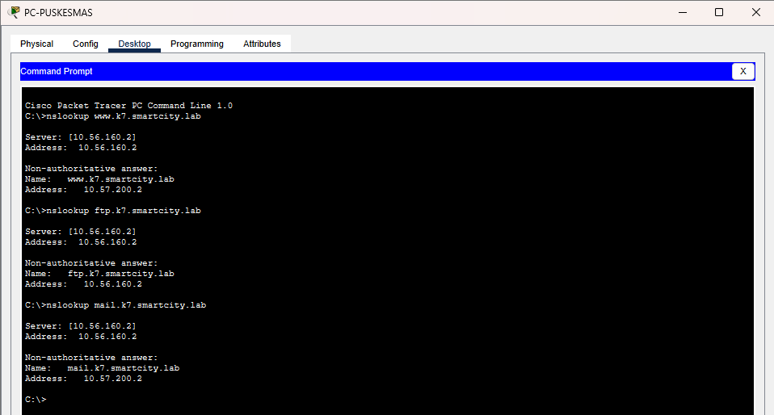

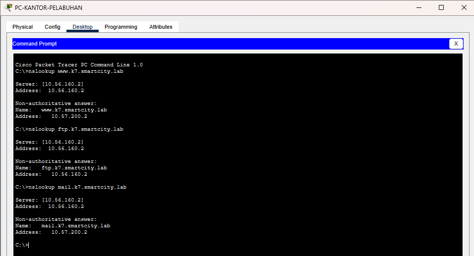

Hasil pengujian menunjukkan bahwa ketiga nama dijawab oleh server `10.56.160.2` dengan alamat yang sesuai tabel record.

### 8b. Web

Layanan web dijalankan pada **SERVER-BALAI** melalui menu **Services → HTTP**. Layanan HTTP diaktifkan (**On**), kemudian berkas `index.html` bawaan diganti dengan halaman "Portal Smart City Surabaya" yang mencantumkan nomor kelompok:

```html
<html>
<head><title>Portal Smart City Surabaya</title></head>
<body>
<center>
<h1>Portal Smart City Surabaya</h1>
<h3>Kelompok 7</h3>
<p>Mid-Project Komunikasi Data dan Jaringan Komputer</p>
</center>
</body>
</html>
```

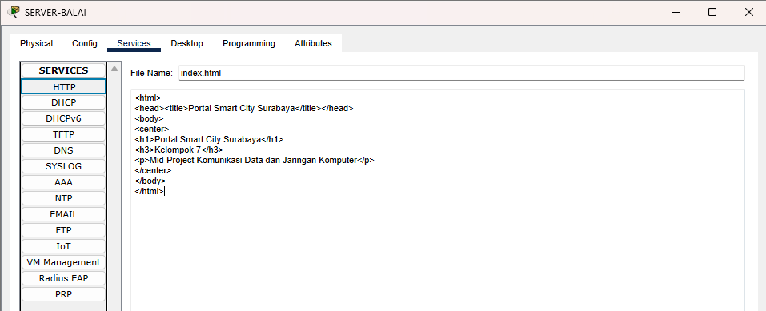

Pengujian dilakukan melalui **Desktop → Web Browser** dengan membuka nama domain `http://www.k7.smartcity.lab` (bukan alamat IP) dari Surabaya Barat dan Pelabuhan:

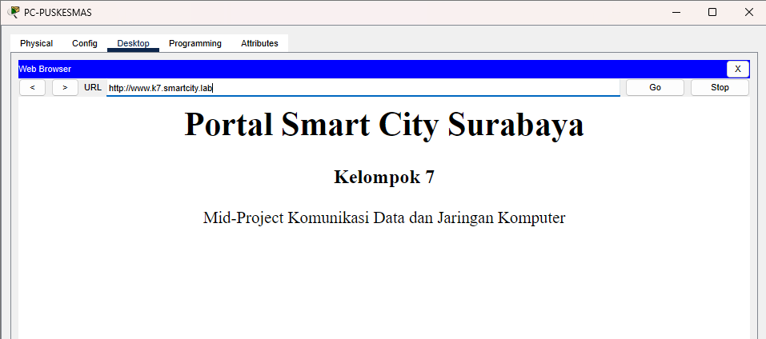

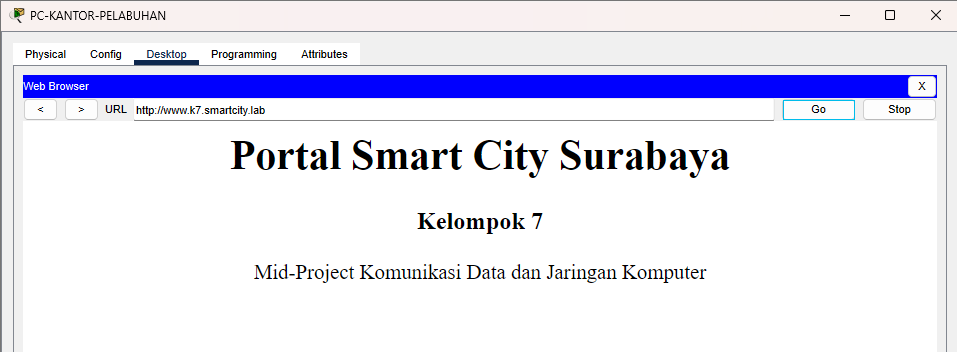

Hasil pengujian menunjukkan bahwa halaman portal dapat dibuka menggunakan nama domain dari kedua wilayah.

### 8c. FTP

Layanan FTP dijalankan pada **SERVER-DC** melalui menu **Services → FTP** sebagai penyimpanan rekaman CCTV. Layanan diaktifkan (**On**), kemudian dibuat satu akun login khusus untuk perangkat CCTV:

| Username | Password | Izin |
|---|---|---|
| cctv | cctv123 | Write, Read, Delete, Rename, List (RWDNL) |

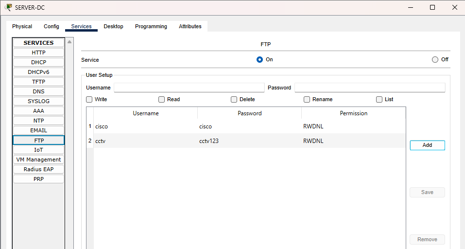

Pengujian dilakukan dari **PC-CCTV-KOTA** yang berada pada LAN CCTV Kota. Berkas `rekaman-cctv.txt` dibuat melalui **Desktop → Text Editor**, kemudian diunggah ke server melalui Command Prompt:

```cmd
ftp ftp.k7.smartcity.lab
put rekaman-cctv.txt
dir
quit
```


Login menggunakan akun `cctv` berhasil, berkas terkirim, dan perintah `dir` menampilkan berkas `rekaman-cctv.txt` pada server. Berkas tersebut juga terlihat pada daftar berkas FTP di SERVER-DC:

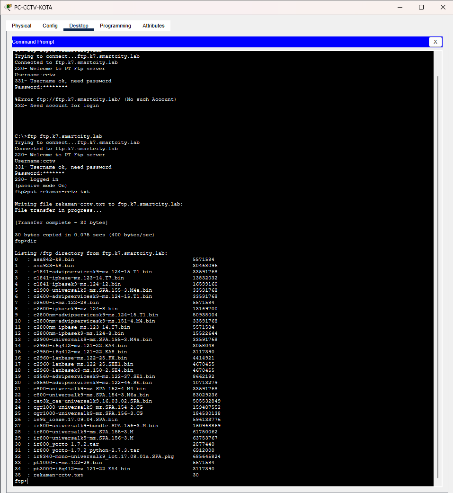

### 8d. Email

Layanan email dijalankan pada **SERVER-BALAI** melalui menu **Services → EMAIL**. Layanan SMTP dan POP3 diaktifkan (**On**), domain diatur menjadi `k7.smartcity.lab`, kemudian dibuat dua akun untuk pengguna di Balai Kota dan di Pelabuhan:

| User | Password | Digunakan pada |
|---|---|---|
| pegawai | pegawai123 | PC-PEGAWAI (Balai Kota) |
| pelabuhan | pelabuhan123 | PC-KANTOR-PELABUHAN (Pelabuhan) |

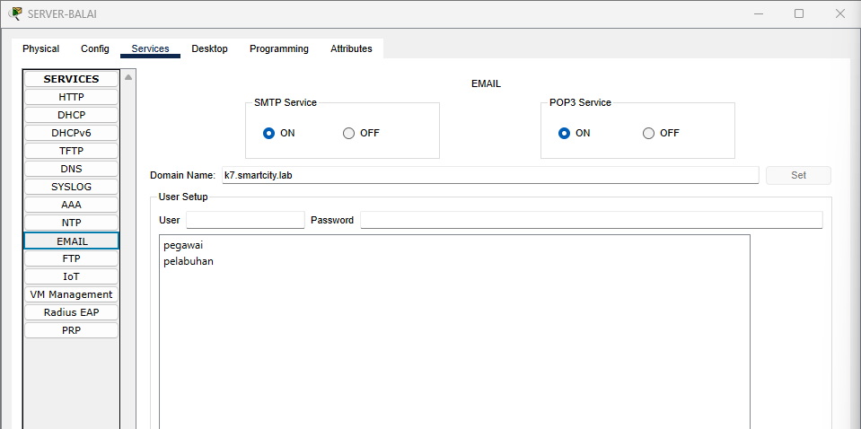

Klien email dikonfigurasi pada kedua perangkat melalui **Desktop → Email → Configure Mail**:

| Parameter | PC-PEGAWAI | PC-KANTOR-PELABUHAN |
|---|---|---|
| Your Name | Pegawai Balai Kota | Kantor Pelabuhan |
| Email Address | pegawai@k7.smartcity.lab | pelabuhan@k7.smartcity.lab |
| Incoming Mail Server | mail.k7.smartcity.lab | mail.k7.smartcity.lab |
| Outgoing Mail Server | mail.k7.smartcity.lab | mail.k7.smartcity.lab |
| User Name | pegawai | pelabuhan |
| Password | pegawai123 | pelabuhan123 |

Pengujian dilakukan secara dua arah. Email dikirim dari PC-PEGAWAI ke `pelabuhan@k7.smartcity.lab`, kemudian diterima pada PC-KANTOR-PELABUHAN:

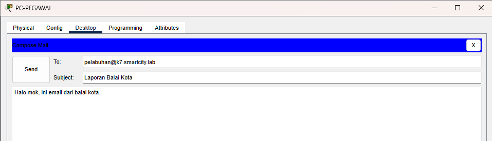

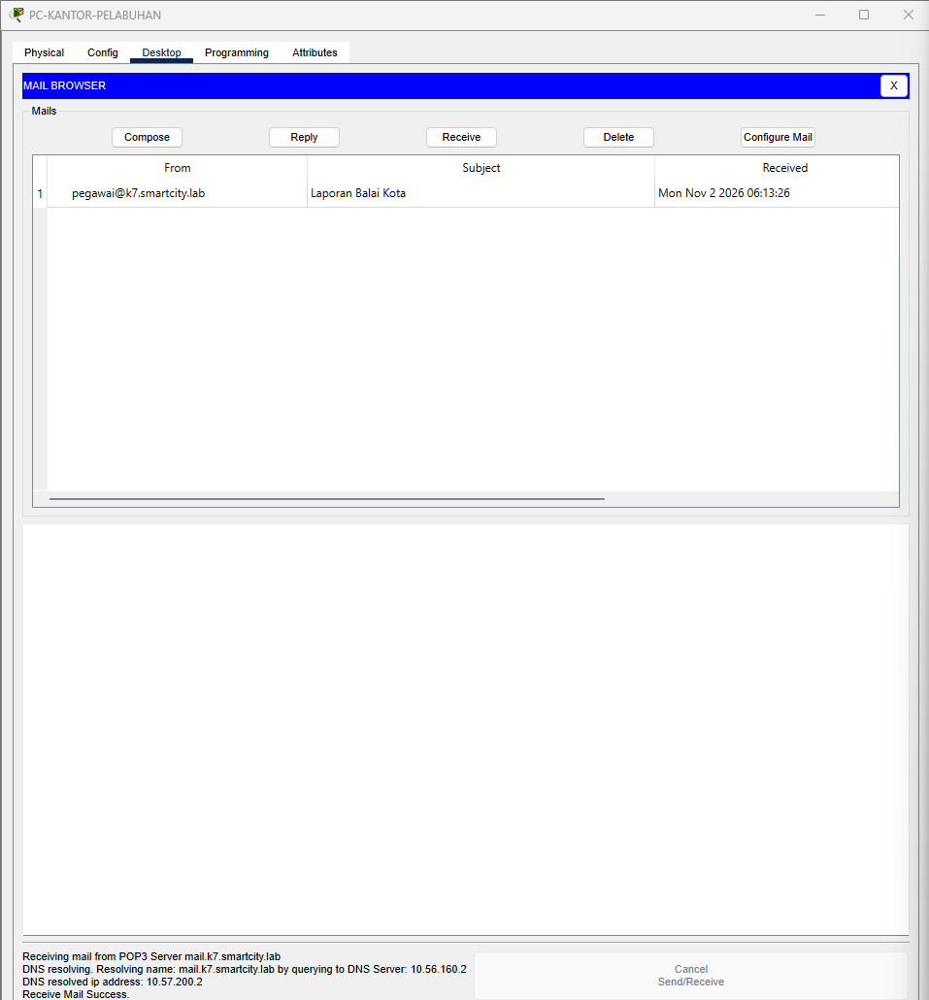

Balasan dikirim dari PC-KANTOR-PELABUHAN ke `pegawai@k7.smartcity.lab`, kemudian diterima pada PC-PEGAWAI:

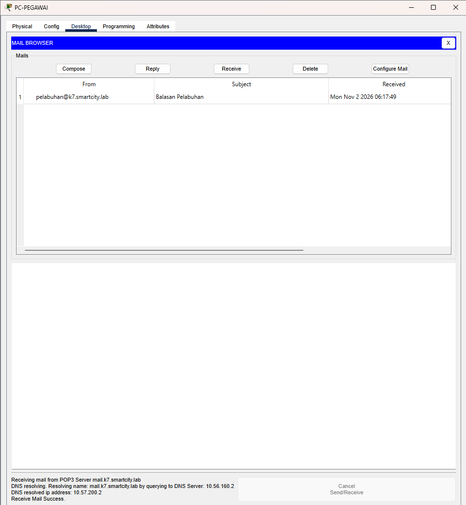

Karena SERVER-BALAI berada pada LAN Server Balai Kota, lalu lintas email dari Pelabuhan menuju server diteruskan melalui Tunnel GRE sesuai static route pada Soal 6.

### Ringkasan Pengujian Layanan Aplikasi

| Layanan | Sumber Pengujian | Hasil |
|---|---|---|
| DNS (`nslookup` www, ftp, mail) | PC-PUSKESMAS, PC-KANTOR-PELABUHAN | Berhasil |
| Web melalui nama domain | PC-PUSKESMAS, PC-KANTOR-PELABUHAN | Berhasil |
| FTP login dan unggah berkas | PC-CCTV-KOTA | Berhasil |
| Email dua arah | PC-PEGAWAI, PC-KANTOR-PELABUHAN | Berhasil |